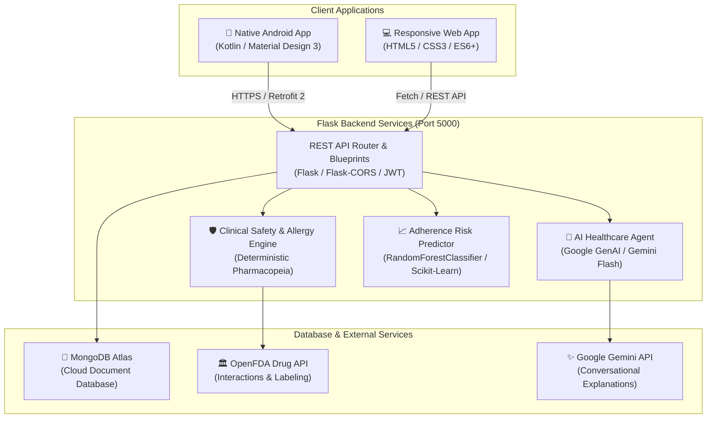

# MediCare+ Platform — Complete Technology Stack Specification

Comprehensive architectural and technology stack documentation for the **MediCare+** ecosystem, encompassing the **Native Android Application**, **Python/Flask Backend**, **Random Forest Machine Learning Pipeline**, **Generative AI Safety Engine**, and **Accessible Web Application**.

---

## 1. System Architecture Overview

---

## 2. Master Technology Stack Matrix

| Category | Technology | Version / Specification | Role in MediCare+ |
| :--- | :--- | :--- | :--- |
| **Android Language** | [Kotlin](https://kotlinlang.org/) | 1.9+ (JVM 17) | Core language for the native Android application |
| **Android SDK** | Android SDK | Target SDK 34 (Android 14), Min SDK 26 (Android 8.0) | Platform target supporting modern Android APIs |
| **Android UI** | Material Design 3 (MD3) | `com.google.android.material:material` | Native buttons, cards, filter chips, and bottom sheets |
| **Android Graphics** | Custom Canvas | Android Canvas 2D API | Custom dynamic circular adherence gauge ([`CircularProgressView.kt`](file:///c:/Users/lenovo/AndroidStudioProjects/Medicare/app/src/main/java/com/example/medicare/CircularProgressView.kt)) |
| **Android Network** | [Retrofit 2](https://square.github.io/retrofit/) & [OkHttp 3](https://square.github.io/okhttp/) | Retrofit 2.9+, OkHttp 3.14+ | Type-safe HTTP REST client with JSON mapping |
| **Android JSON** | Gson | `converter-gson:2.9.0` | Serialization and deserialization of API models |
| **Android Alarms** | Android AlarmManager | Exact Alarms (`setExactAndAllowWhileIdle`) | Background reminder trigger with wake-lock support |
| **Backend Runtime** | [Python](https://www.python.org/) | Python 3.14 / 3.11+ | Server runtime environment |
| **Backend Framework** | [Flask](https://flask.palletsprojects.com/) | Flask 3.x | Lightweight WSGI web framework and modular blueprints |
| **Backend CORS** | Flask-CORS | Flask-CORS 4.x | Cross-Origin Resource Sharing for web & hybrid clients |
| **Authentication** | [Flask-JWT-Extended](https://flask-jwt-extended.readthedocs.io/) | JWT (HS256) | Bearer token authentication, claims, and route guards |
| **Password Hashing** | Passlib / BCrypt | `passlib[bcrypt]` | Salted cryptographic password hashing |
| **Machine Learning** | [Scikit-Learn](https://scikit-learn.org/) | Scikit-Learn 1.9+ | Supervised **Random Forest Classifier** (`RandomForestClassifier`) |
| **ML Serialization** | [Joblib](https://joblib.readthedocs.io/) | Joblib 1.4+ | High-performance binary model loading (`adherence_model.joblib`) |
| **Scientific Computing** | [NumPy](https://numpy.org/) | NumPy 2.x | Numerical array vectorization for ML feature matrices |
| **AI / LLM SDK** | [Google GenAI SDK](https://github.com/googleapis/python-genai) | `google-genai` | Official Google GenAI SDK interfacing Gemini models |
| **AI Foundation Model** | [Gemini Flash](https://ai.google.dev/) | `gemini-flash-lite-latest` | Context-aware, low-latency medication conversational assistant |
| **Database** | [MongoDB Atlas](https://www.mongodb.com/atlas) | MongoDB 7.0+ (Cloud Cluster) | Distributed NoSQL document storage |
| **Database Driver** | [PyMongo](https://pymongo.readthedocs.io/) | PyMongo 4.x | Python MongoDB driver with connection pooling |
| **WSGI Server** | [Gunicorn](https://gunicorn.org/) | Gunicorn 21+ | Multi-worker production WSGI application server |
| **Web Markup** | HTML5 Semantic DOM | WCAG 2.1 AAA Compliant | Screen-reader accessible layout and modal dialogs |
| **Web Styling** | Vanilla CSS3 | Custom Design Tokens | MD3 tonal palette, dark theme, high-contrast, dual viewport |
| **Web Typography** | Google Fonts | Atkinson Hyperlegible Next | Specially engineered low-vision senior legibility font |
| **Web Logic** | Vanilla JavaScript | ECMAScript 2022+ (ES6+) | LocalStorage offline caching and asynchronous API orchestration |
| **Web Audio/Speech** | Web Audio & Speech API | Native Browser APIs | Dual-tone synthesized alarm chimes and text-to-speech engine |
| **Testing Suite** | [Pytest](https://docs.pytest.org/) & Unittest | Pytest 8.x | Automated unit, integration, and ML verification test suites |

---

## 3. Deep-Dive Component Breakdown

### A. Machine Learning Pipeline (`Medicare-Backend/ml/`)
The adherence risk engine uses an ensemble machine learning approach:
* **Algorithm**: **`RandomForestClassifier`** from `sklearn.ensemble`
* **Configuration**:
  * `n_estimators`: 100 decision trees
  * `max_depth`: 8 (prevents overfitting to polypharmacy outliers)
  * `random_state`: 42 (reproducible results)
* **Input Feature Matrix (8 Clinical Metrics)**:
  1. `medication_count`: Total active prescribed medications.
  2. `daily_medication_events`: Total medication administration instances scheduled per day.
  3. `missed_doses_7d`: Number of skipped doses logged over the trailing 7 days.
  4. `missed_doses_30d`: Number of skipped doses logged over the trailing 30 days.
  5. `adherence_percentage`: Overall percentage of scheduled doses successfully logged.
  6. `reminder_response_rate`: Frequency of prompt confirmation upon alarm ring.
  7. `consecutive_missed_days`: Current continuous streak of missed doses.
  8. `medication_complexity`: Composite index factoring dosage frequencies and meal constraints.
* **Output Classes**: `LOW` (0), `MEDIUM` (1), `HIGH` (2) Risk.
* **Source Files**:
  * Training Pipeline: [`train_model.py`](file:///c:/Users/lenovo/AndroidStudioProjects/Medicare-Backend/ml/train_model.py)
  * Runtime Inference: [`predictor.py`](file:///c:/Users/lenovo/AndroidStudioProjects/Medicare-Backend/ml/predictor.py)

---

### B. Artificial Intelligence & Clinical Safety Engine (`Medicare-Backend/services/`)
* **Dual-Layer Architecture**:
  1. **Deterministic Safety Guardrail Engine ([`safety_engine.py`](file:///c:/Users/lenovo/AndroidStudioProjects/Medicare-Backend/services/safety_engine.py))**: Rule-based parser that verifies drug allergies (e.g., Penicillin cross-reactivity) and checks drug-drug interactions before any text generation.
  2. **Conversational AI Service ([`ai_service.py`](file:///c:/Users/lenovo/AndroidStudioProjects/Medicare-Backend/services/ai_service.py))**: Powered by `google.genai` SDK with strict medical guardrails:
     * Never diagnoses diseases or recommends modifying prescription dosages.
     * Directs emergencies to urgent medical facilities (911/112).
     * Grounds all responses on the patient's verified profile data.

---

### C. Native Android Application (`Medicare/`)
* **Platform Architecture**:
  * Target Platform: Android API 33+ (Tiramisu / UpsideDownCake).
  * Architecture: Single-Activity & Component-based separation with `ViewBinding`.
* **Key Modules**:
  * [`HomeActivity.kt`](file:///c:/Users/lenovo/AndroidStudioProjects/Medicare/app/src/main/java/com/example/medicare/HomeActivity.kt): Adherence ring and upcoming dose feed.
  * [`AIAssistantActivity.kt`](file:///c:/Users/lenovo/AndroidStudioProjects/Medicare/app/src/main/java/com/example/medicare/AIAssistantActivity.kt): Real-time chat adapter connected to backend.
  * [`AddMedicineActivity.kt`](file:///c:/Users/lenovo/AndroidStudioProjects/Medicare/app/src/main/java/com/example/medicare/AddMedicineActivity.kt): Type selector, frequency chips, and dialog pickers.
  * [`PharmacyActivity.kt`](file:///c:/Users/lenovo/AndroidStudioProjects/Medicare/app/src/main/java/com/example/medicare/PharmacyActivity.kt): Simulated street grid map and pharmacy directory.
  * [`AlarmScheduler.kt`](file:///c:/Users/lenovo/AndroidStudioProjects/Medicare/app/src/main/java/com/example/medicare/AlarmScheduler.kt): Native Android `AlarmManager` integration.

---

### D. Web Application (`Medicare-Web/`)
* **Purpose**: Full-fidelity browser client reproducing all native Android capabilities.
* **Technology Implementation**:
  * **Markup ([`index.html`](file:///c:/Users/lenovo/AndroidStudioProjects/Medicare-Web/index.html))**: Accessible semantic layout with modal dialogues and SVG icons.
  * **Style Engine ([`index.css`](file:///c:/Users/lenovo/AndroidStudioProjects/Medicare-Web/css/index.css))**: Atkinson Hyperlegible Next typography, high-contrast mode (WCAG AAA), and smooth animations.
  * **Dual Viewport Switcher**: Instantly toggles between an authentic **Mobile Phone Shell** (with dynamic island status bar) and an expanded **Desktop Clinical Dashboard**.
  * **Synthesizer & Audio ([`app.js`](file:///c:/Users/lenovo/AndroidStudioProjects/Medicare-Web/js/app.js))**: Web Audio API harmonic two-tone alarm synthesizer and Web Speech API speech synthesis.

---

### E. Database Collections Schema (`database/mongo.py`)
* `users`: Authentication records, email index, hashed passwords, roles (`patient`, `doctor`).
* `patients`: Clinical profiles, blood group, emergency contacts, recorded allergies, accessibility settings.
* `medicines`: Patient medication regimens, dosage, frequency, reminder times, inventory counter, compliance history.
* `appointments`: Booking schedules between doctors and patients.
* `notifications`: Log of queued and dispatched medication alerts.

---

*Generated and verified for the MediCare+ code repository.*
